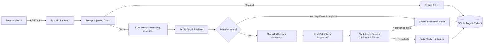

# SupportPilot AI

An end-to-end AI customer-support agent built for **Northstar Shop** (a fictional e-commerce retailer). SupportPilot AI answers customer questions strictly from a company knowledge base using Retrieval-Augmented Generation (RAG), classifies intent with validated JSON, scores answer groundedness, and automatically escalates low-confidence or sensitive inquiries (legal, fraud, formal complaints) to human specialists.

---

## Problem Statement

Customer support teams face high ticket volume for repetitive policy questions (returns, shipping, refunds, warranties), while high-risk inquiries (fraud, legal threats, edge-case exceptions) require immediate human judgment. Naive LLM chatbots hallucinate policies or get tricked by prompt injections. **SupportPilot AI** solves this by:
1. Grounding every answer in versioned markdown KB policies with inline source citations (`[doc_name#chunk_id]`).
2. Enforcing a two-stage confidence + sensitivity gate before replying.
3. Logging every decision, retrieved source, confidence score, and latency to SQLite for full observability.

---

## Architecture



### Major Modules (2–3 Line Interview Summary)
- **`backend/app/llm.py`**: Defines the `LLMProvider` abstract base class and `OpenAICompatibleProvider` adapter so Groq (`llama-3.1-8b-instant`), OpenAI, or Gemini can be swapped via a single environment variable (`LLM_PROVIDER`).
- **`backend/app/rag.py`**: Implements overlapping token-based chunking (`500` tokens, `50` overlap), `all-MiniLM-L6-v2` embedding normalization, and a disk-persisted `faiss.IndexFlatIP` vector store.
- **`backend/app/guardrails.py`**: Provides deterministic regex/structural prompt-injection detection on user inputs, context sanitization on retrieved chunks, and keyword-based sensitivity triggers (legal/fraud/complaints).
- **`backend/app/agent.py`**: Orchestrates the `POST /chat` pipeline—injection guard, strict JSON intent classification, top-4 retrieval, grounded generation, LLM self-check, confidence scoring, and ticket escalation.
- **`backend/app/database.py` & `main.py`**: SQLAlchemy models (`Ticket`, `ConversationLog`) and FastAPI endpoints (`/health`, `/ingest`, `/chat`, `/admin/*`) with CORS and automatic startup indexing.
- **`eval/run_eval.py`**: Evaluates 60 hand-written test cases (`eval/golden.json`) for Retrieval Hit@4, LLM-as-Judge Answer Correctness, Escalation Precision/Recall, Injection/OOS Resistance, and Latency.

---

## Setup in Under 10 Minutes

### Prerequisites
- Python 3.11+ (3.10+ compatible)
- Node.js 20+
- A free [Groq API key](https://console.groq.com/)

### 1. Clone & Configure
```bash
git clone <your-repo-url>
cd supportpilot-ai
cp .env.example .env
# Edit .env and set LLM_API_KEY=gsk_...
```

### 2. Backend (Local)
```bash
python -m venv .venv
# Windows: .venv\Scripts\activate  |  macOS/Linux: source .venv/bin/activate
pip install -r backend/requirements.txt
uvicorn app.main:app --app-dir backend --reload --port 8000
```
On startup, the backend automatically chunks and embeds `data/kb/*.md` into `data/faiss_index/` if no index exists yet.

### 3. Frontend (Local)
```bash
cd frontend
npm install
npm run dev
```
Open `http://localhost:5173`.

### 4. Run Tests & Evaluation
```bash
pytest -v
python eval/run_eval.py
```

---

## API Documentation

| Method | Endpoint | Description |
|---|---|---|
| `GET` | `/health` | Health check returning index status, chunk count, and LLM configuration. |
| `POST` | `/ingest` | Re-chunks (`500` tokens, `50` overlap) and re-indexes `data/kb/*.md` into FAISS. |
| `POST` | `/chat` | Body: `{"message": "..."}`. Runs guardrails, intent classification, RAG, confidence check, and returns `decision`, `answer`, `intent`, `confidence`, `sources`, `ticket_id`, `latency_ms`. |
| `GET` | `/admin/tickets` | Lists escalated support tickets awaiting human follow-up. |
| `GET` | `/admin/conversations` | Lists all logged `/chat` requests with sources, confidence, decision, and latency. |
| `GET` | `/admin/metrics` | Returns `total_requests`, `auto_resolved`, `escalated`, `refused`, `auto_resolve_rate`, `escalation_rate`, and `avg_latency_ms`. |

---

## Evaluation Results

Evaluated end-to-end on **60** hand-written test cases ([eval/golden.json](eval/golden.json): 40 answerable, 10 should-escalate, 10 out-of-scope/prompt-injection) using `qwen/qwen3.8-27b` on Groq and `all-MiniLM-L6-v2` + FAISS (saved in [eval/results.md](eval/results.md)):

| Metric | Result |
|---|---|
| Retrieval Hit@4 (40 answerable) | **40/40 (100.0%)** |
| Answer Correctness (LLM-as-Judge >= 4/5) | **39/40 (97.5%)** |
| Mean Judge Score | **4.72 / 5.00** |
| Escalation Precision | **90.9% (10/11)** |
| Escalation Recall | **100.0% (10/10)** |
| Injection & OOS Resistance Rate | **10/10 (100.0%)** |
| Average Latency (incl. free-tier 429 backoff) | **11,139.0 ms** |

### Failure Analysis
- **Case 18 (False Escalation, `conf=0.2393`)**: Query *"Can I add another item to an order I already placed?"* retrieved `order_cancellation_changes.md` in top-4 (Hit@4 succeeded), but with a lower top-1 cosine similarity (`~0.40`) and a conservative `"no"` from the LLM self-check (`0.6 * 0.3988 + 0.4 * 0 = 0.2393 < 0.55`). Because the policy states *"We cannot add, remove, or swap items in an existing order"*, the phrasing mismatch lowered retrieval confidence and triggered a safe-side human escalation.
- **Latency Inflation in Batch Eval**: Sequential execution of 60 cases (~180 LLM calls) hit Groq free-tier RPM/TPM limits, triggering `429` retry-backoff sleeps; single-request interactive latency is ~0.5–1.5s.

### What Is Misleading About My Headline Number
- **Hit@4 vs Hit@1**: A 100% Hit@4 means the right document was *somewhere* in the top 4 chunks, not necessarily #1. Because the confidence formula uses `top_similarity` (chunk #1), a correct document ranked #2–#4 with a lower top-1 score can still trigger an unnecessary escalation (as seen in Case 18).
- **LLM-as-Judge bias**: Using the same model family (`qwen/qwen3.8-27b`) as both generator and judge can inflate correctness scores when the judge shares the generator's blind spots.
- **Synthetic golden set**: The 60 hand-written queries are clean, single-turn English questions; real customer tickets contain typos, multi-part questions, and emotional ambiguity.

---

## Decision Log (5 Design Trade-offs)

1. **FAISS on Disk vs. pgvector / Managed Vector DB**
   - *Choice*: `faiss-cpu` persisted to disk (`index.faiss` + `chunks.json`).
   - *Why*: Zero external database cost, sub-5ms retrieval for <10k chunks, and trivial Docker build-time indexing. Trade-off: single-node only; would migrate to `pgvector` or Qdrant for multi-replica horizontal scaling or live per-document mutations.
2. **Small Fast Model (`llama-3.1-8b-instant`) vs. Frontier Model (`gpt-4o` / `70b`)**
   - *Choice*: Groq `llama-3.1-8b-instant` behind an `LLMProvider` abstraction.
   - *Why*: Sub-second inference and free-tier friendly for rapid prototyping. Strict JSON validation and a separate groundedness self-check compensate for weaker reasoning, while `LLMProvider` allows one-env-var upgrades.
3. **Confidence Threshold (`0.55`) & Composite Score (`0.6 * sim + 0.4 * self_check`)**
   - *Choice*: `0.55` default threshold combining normalized cosine similarity and binary LLM self-check.
   - *Why*: If the LLM self-check says `"no"`, max possible confidence is `0.60 * 1.0 = 0.60` (and with typical `sim <= 0.85`, `<= 0.51`), which reliably forces escalation. Setting it higher (`0.75`) reduces hallucinations further at the cost of higher human escalation volume.
4. **Chunk Size (`500` tokens, `50` overlap)**
   - *Choice*: 500-word/token chunks with 50-token overlap.
   - *Why*: Most Northstar Shop policy docs are 150–300 words, so each policy fits cleanly in 1 chunk without splitting mid-rule, while longer docs retain context across boundaries.
5. **Deterministic Regex Guardrails + LLM Classification vs. Pure LLM Guardrails**
   - *Choice*: Deterministic regex patterns for known jailbreaks and legal/fraud keywords *before* or *alongside* the LLM.
   - *Why*: Blocks obvious prompt injections in <1ms with zero LLM token cost and guarantees legal/fraud threats never slip through due to stochastic LLM classification.

---

## Limitations
- **Render Free Tier Sleep**: The free Render web service spins down after 15 minutes of inactivity; the first request after sleep takes ~30–50 seconds to cold-start.
- **Single-turn**: `POST /chat` is stateless per request (no multi-turn conversation memory yet).
- **Ephemeral SQLite on Free PaaS**: On Render's free tier without a persistent disk, SQLite resets on redeploy.

